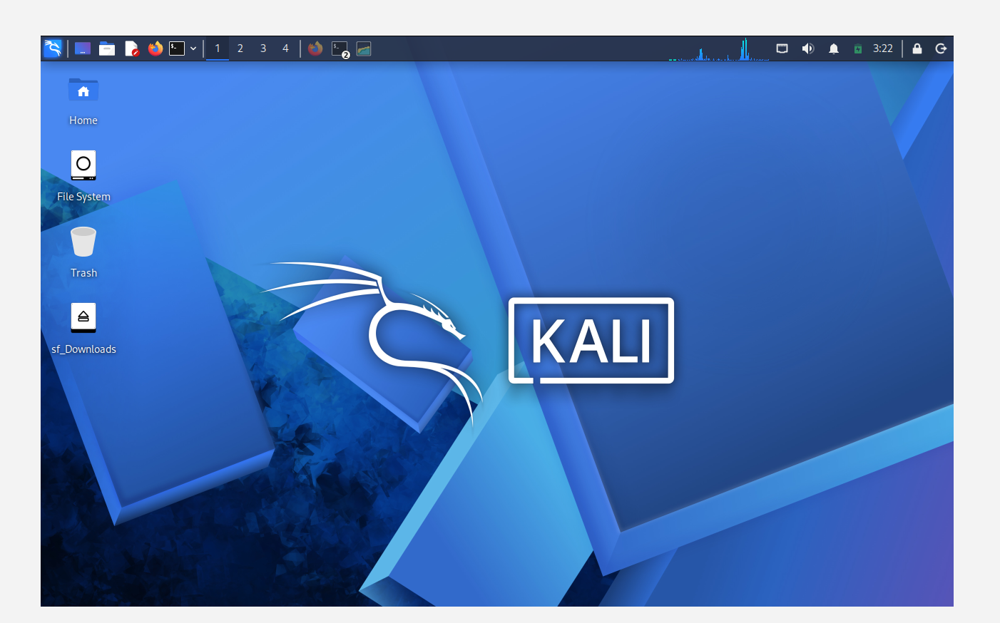

# Cybersecurity Testing Lab Setup Using VirtualBox & Kali Linux

##  Project Overview

As part of my cybersecurity learning journey, I completed Week 1 – Project Module 1 (WK1-PM1), focusing on setting up a virtual cybersecurity testing lab using Oracle VirtualBox and Kali Linux.

The goal was to create an isolated virtual environment for practising ethical hacking, network reconnaissance, penetration testing, and cybersecurity techniques.

## Tools & Technologies

- **Oracle VirtualBox** – Virtualisation platform.
- **Kali Linux** – Attacker machine for cybersecurity testing.
- **7-Zip** – File extraction and management.
- **NAT Network** – Virtual network configuration.
- **Linux Terminal** – Network and system configuration.

## Lab Configuration

| Component | Configuration |
| Virtualisation | Oracle VirtualBox |
| Operating System | Kali Linux |
| Network Type | NAT Network |
| Network Subnet | 10.0.0.0/24 |
| Kali Linux IP | 10.0.0.2/24 |
| Internet Access | Enabled |
| Shared Folder | Host `/downloads` |
| Clipboard | Enabled |
| Drag & Drop | Enabled |

## 🎯 Project Objectives

1. Install and configure Oracle VirtualBox.
2. Create a NAT Network using the subnet.
3. Download and import the Kali Linux virtual machine.
4. Configure Kali Linux with a static IP address of.
5. Enable internet connectivity.
6. Configure shared folders, clipboard, and drag-and-drop functionality.
7. Take a virtual machine snapshot for recovery and future lab activities.

## Skills Developed

- Virtualisation and virtual machine management.
- Kali Linux installation and configuration.
- Basic networking and IP addressing.
- NAT Network configuration.
- Linux system administration.
- Cybersecurity lab preparation.
- Troubleshooting network connectivity.

## Future Plans

This lab will serve as the foundation for future practical cybersecurity exercises, including:

- Network scanning and reconnaissance.
- Vulnerability assessment.
- Ethical hacking practice.
- Penetration testing.
- Network security analysis.

## Key Takeaway

This project gave me practical experience building a cybersecurity testing environment from scratch. It is an important step in developing my technical skills and working towards a career in cybersecurity.

**Learning by doing. Securing the digital world, one project at a time!**

#KaliLinux #CyberSecurity #EthicalHacking #VirtualBox #Linux #Networking #PenetrationTesting #CyberSecurityJourney #GitHub #InfoSec
## Screenshot of my lab Setup 

